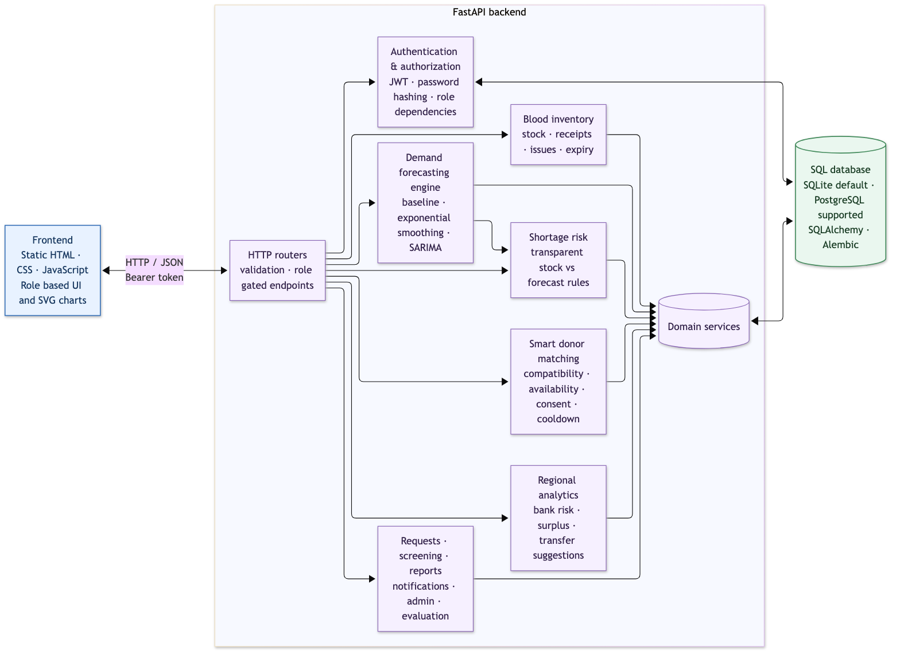
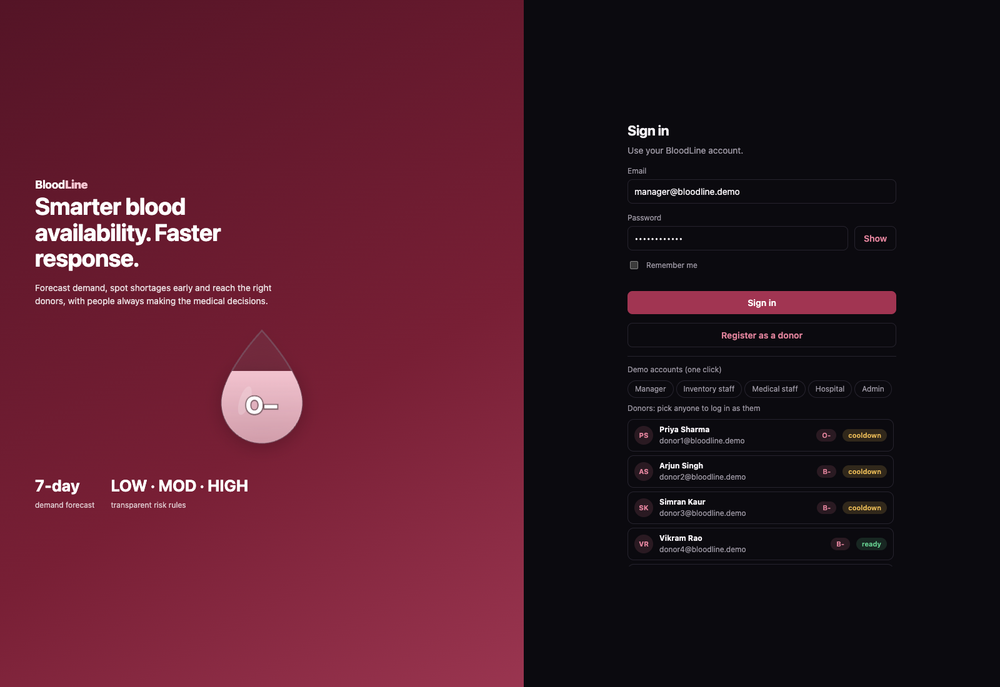
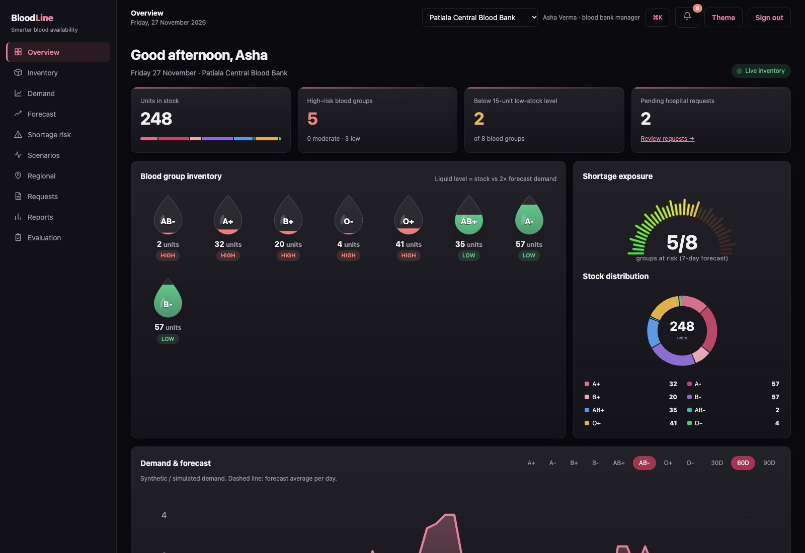
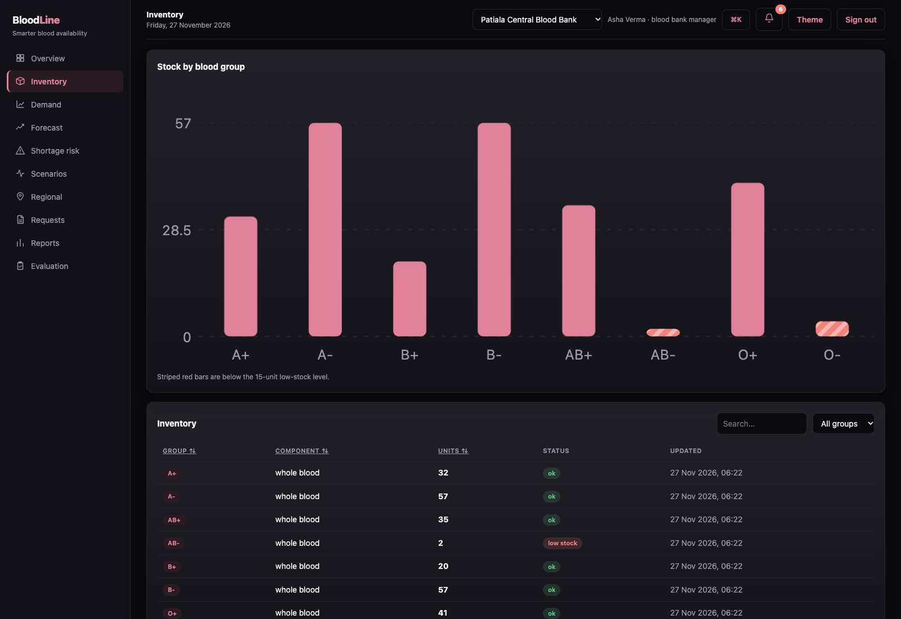
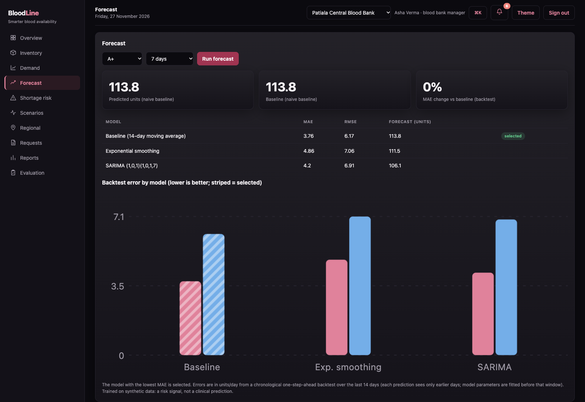
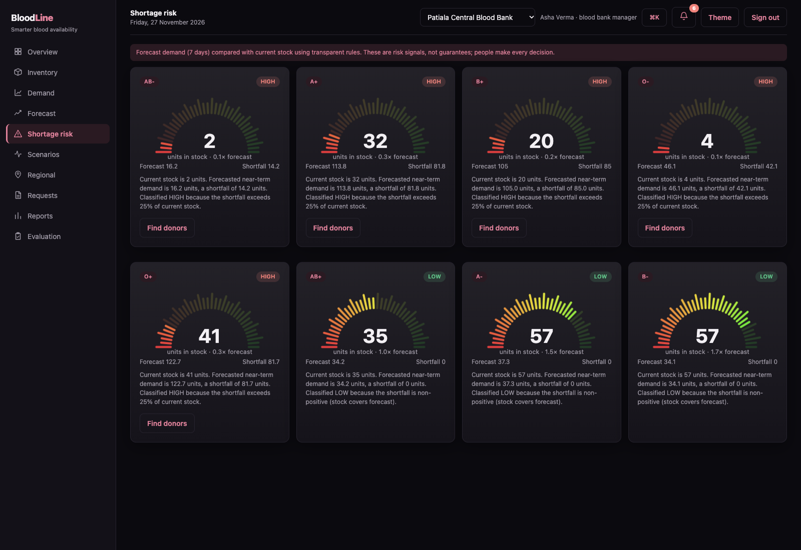
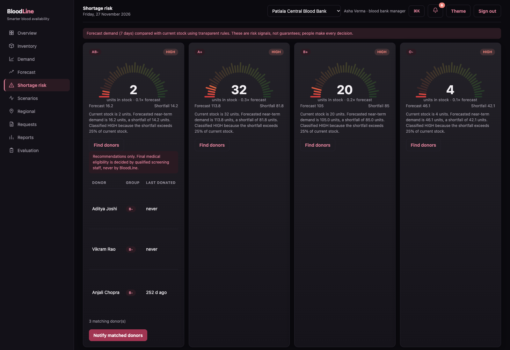
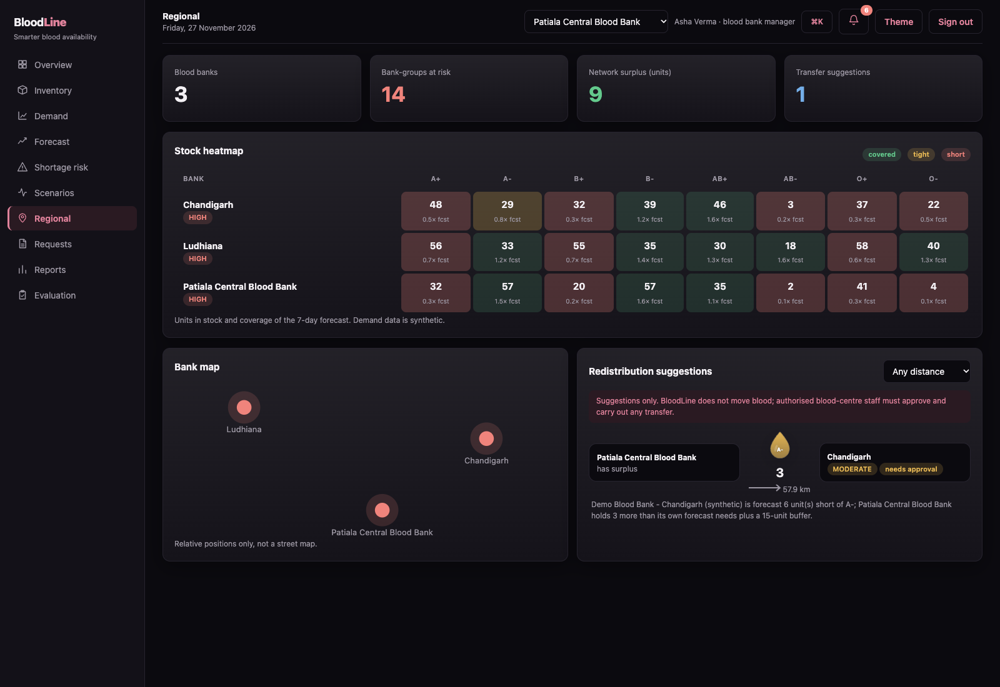

# BloodLine

   

BloodLine is a role based blood bank management and decision support application. It combines inventory workflows with short term demand forecasts, explainable shortage flags, donor suggestions and multi bank summaries. The backend is a FastAPI and SQLAlchemy service; the frontend is a static HTML, CSS and JavaScript application with no build step. Demand history is synthetic. Forecasts and donor matches are operational aids, not validated clinical predictions or medical eligibility decisions.

> **Live deployment:** <https://bloodline-avrajsekhon-ui.onrender.com> (frontend) · API docs: <https://bloodline-avrajsekhon-api.onrender.com/docs>. Hosted on Render's free tier with a Neon PostgreSQL database, so the first visit after a period of inactivity can take about a minute while the service wakes up.

> **Data and safety note:** Seeded demand is synthetic/simulated. Donor matching only recommends candidates to authorized staff. Staff perform screening and make eligibility decisions; transfers between banks are suggestions requiring human approval.

## Contents

- [Problem and objectives](#problem-and-objectives)
- [Features](#features)
- [Technology](#technology)
- [Architecture](#architecture)
- [Modules](#modules)
- [Forecasting and shortage risk](#forecasting-and-shortage-risk)
- [Donor matching](#donor-matching)
- [Data and backend](#data-and-backend)
- [Deployment](#deployment)
- [Local development](#local-development)
- [Configuration](#configuration)
- [Docker](#docker)
- [API and tests](#api-and-tests)
- [Limitations and future work](#limitations-and-future-work)
- [Contributors](#contributors)
- [Screenshots](#screenshots)

## Problem and objectives

Blood banks need to coordinate stock, incoming donations, requests and time sensitive shortages across different roles. BloodLine provides one prototype workflow for recording stock movements, reviewing demand patterns, surfacing stock risk and finding potential donors.

The objectives are to:

1. Make inventory and request activity visible to role appropriate users.
2. Compare simple forecasting candidates using a chronological backtest.
3. Explain shortage flags with a transparent rule.
4. Present compatible, available donor suggestions with reasons and optional distance filtering.
5. Summarize regional stock and possible redistribution for human review.

## Features

| Area | Implemented behavior |
|---|---|
| Identity and roles | Password login, JWT bearer tokens, role checks, donor registration and profile workflows |
| Inventory | Receipts and issues, transaction history, expiry support and stock validation |
| Requests | Hospital request submission; manager approval or rejection; approval can issue available stock |
| Demand and forecasting | Synthetic demand history; baseline, exponential smoothing and optional SARIMA candidates; MAE/RMSE reporting |
| Risk | Per blood group LOW/MODERATE/HIGH flags, explanations and alert history |
| Donors | Compatibility filtering, availability, consent, 90 day cooldown, optional radius and ranked match reasons |
| Screening | Candidate worklist and human entered eligible/deferred/rejected records |
| Regional view | Multiple bank stock/risk overview, interactive OpenStreetMap bank map with a shortage heatmap filterable by blood group (Leaflet), and redistribution suggestions requiring human approval |
| Reports and evaluation | Inventory/request summaries, forecast and risk evaluation, matching rule checks; browser print-to-PDF |
| Notifications | In-app notifications and optional Web Push when VAPID is configured |
| Demo tools | Read-only demand what-if view and optional simulated stock scenario endpoints |

## Technology

| Layer | Technologies verified in the project |
|---|---|
| Frontend | Static HTML, CSS and vanilla JavaScript; hand-built SVG charts; service worker for optional push |
| API | Python 3.12 image, FastAPI, Uvicorn, Pydantic |
| Persistence | SQLAlchemy 2, SQLite by default, PostgreSQL supported with psycopg2 |
| Schema changes | Alembic; optional `create_all` startup for local mode |
| Forecasting | NumPy, pandas; statsmodels SARIMA candidate |
| Authentication | Passlib/bcrypt password hashing, python-jose JWT |
| Packaging and checks | Docker Compose, pytest, HTTPX, Ruff |

## Architecture

The diagram reflects the current static frontend, router/service split and shared SQLAlchemy database. Authentication is enforced by FastAPI dependencies on protected routes. Route access varies by role; not every module is available to every role.



Editable source: [assets/architecture.mmd](assets/architecture.mmd).

## Modules

| Module | Responsibilities |
|---|---|
| `code/backend/app/routers/` | HTTP routes for auth, inventory, demand, forecasts, risk, donors, requests, screening, reports, regional views, notifications and admin workflows |
| `code/backend/app/services/forecasting.py` | Candidate forecasts, chronological error metrics, optional SARIMA and model selection |
| `code/backend/app/services/risk.py` | Shortfall calculation and deterministic risk classification |
| `code/backend/app/services/donor_matching.py` | Compatibility and eligibility-to-contact filters, scoring and ranking |
| `code/backend/app/services/regional.py` | Surplus calculation and suggested matching of regional surplus to shortages |
| `code/backend/app/services/synthetic_data.py` | Reproducible synthetic demand generation |
| `code/backend/app/services/evaluation.py` | Backtest summaries, simulated shortage detection evaluation and independent matching-rule checks |
| `code/backend/app/models.py`, `schemas.py`, `database.py` | SQLAlchemy data model, API validation/serialization and database sessions |
| `code/backend/app/auth.py` | JWT validation and role dependency checks |
| `code/frontend/index.html`, `viz.js`, `ml-pages.js` | Single-page role based UI, charts and forecasting-oriented views |
| `code/backend/alembic/` | Alembic environment and baseline schema revision |

## Forecasting and shortage risk

For the requested horizon, the forecasting service compares:

1. **Naive baseline:** mean demand over the latest 14 observations, extended across the requested horizon.
2. **Simple exponential smoothing:** level updated with alpha 0.3 and held flat across the horizon.
3. **SARIMA (optional):** order `(1,0,1)`, seasonal order `(1,0,1,7)`. It requires at least 60 observations and statsmodels; it can be disabled with `BLOODLINE_SARIMA=0` and falls back when unavailable or fitting fails.

The service selects the candidate with the lowest MAE over a chronological rolling one-step-ahead holdout (up to the latest 14 days); it also reports RMSE. SARIMA evaluation fits parameters before the holdout and keeps them frozen across it. These results describe performance on synthetic history, not clinical validity or future production accuracy.

Shortage risk is a transparent rule applied to predicted demand and current stock:

| Rule | Level |
|---|---|
| Stock covers forecast (`shortfall <= 0`) | LOW |
| Positive shortfall up to 25% of current stock | MODERATE |
| Shortfall above 25% of current stock | HIGH |
| Zero stock with positive forecast | HIGH |

The API returns the stock, predicted demand, nonnegative shortfall, level and a plain language explanation. Risk history is stored and repeated alerts are de-duplicated by the route logic.

## Donor matching

Matching uses the whole blood compatibility table in `services/donor_matching.py`. It filters out incompatible groups, donors who are unavailable, donors without notification consent, and donors inside the 90 day cooldown. When a radius is supplied, a donor must have a known location within it. Remaining candidates are ranked by a score that considers exact blood group, donation history and distance; the response includes the reasons and distance when available.

This is a candidate contact list, not a medical clearance. The application records screening outcomes entered by medical staff; donation recording requires an eligible screening. Compatibility is a simplified whole blood rule and is not component specific.

## Data and backend

FastAPI routers depend on shared SQLAlchemy sessions from `database.py`. Models are defined in `models.py`; Pydantic schemas validate route input and output. SQLite at `./bloodline.db` is the default. Set `DATABASE_URL` to a PostgreSQL SQLAlchemy URL to use PostgreSQL. In local mode, `main.py` calls `Base.metadata.create_all`; set `BLOODLINE_USE_MIGRATIONS=1` to leave schema setup to Alembic. The provided `0001_baseline` revision creates current model metadata but does not create roles or users. Run the additive `python -m app.bootstrap` command after migrations to initialize the first administrator and synthetic planning data; it does not remove or modify existing application data.

## Deployment

BloodLine is deployed on [Render](https://render.com) from the `master` branch:

| Component | Render service | URL |
|---|---|---|
| Frontend | Static Site (`code/frontend`, built with `python build_static.py`) | <https://bloodline-avrajsekhon-ui.onrender.com> |
| API | Docker Web Service (`code/backend`) | <https://bloodline-avrajsekhon-api.onrender.com> ([docs](https://bloodline-avrajsekhon-api.onrender.com/docs), [health](https://bloodline-avrajsekhon-api.onrender.com/health)) |
| Database | Neon PostgreSQL | private `DATABASE_URL` set in Render |

Pushes to `master` redeploy both services. With `BLOODLINE_FACULTY_DEMO=1` set on the API (the frontend detects it automatically), the login page shows one-click demo accounts (five staff roles and 15 synthetic donors); the API adds this synthetic demo fixture on every start if it is missing, so the demo logins survive redeploys without touching real accounts. The API Docker image disables the SARIMA candidate by default (`BLOODLINE_SARIMA=0`) so dashboards load quickly on small CPUs; set `BLOODLINE_SARIMA=1` to include it. The free tier sleeps after about 15 minutes without traffic, so the first request afterwards is slow. Setup, environment variables and the one-time database bootstrap are documented in the [Render deployment runbook](docs/deployment-render.md). The regional map loads Leaflet from cdnjs and map tiles from OpenStreetMap; without internet access it falls back to a simple relative-position diagram.

## Local development

To run your own copy for development. Requirements: Python 3.12 or a compatible Python release. No Node.js installation or frontend build is required.

```bash
cd code/backend
python3 -m venv .venv
source .venv/bin/activate       # Windows: .venv\Scripts\activate
pip install -r requirements.txt
python -m app.bootstrap        # additive setup; prompts for initial administrator email and password
uvicorn app.main:app --reload --port 8000
```

In another terminal, from the repository root:

```bash
cd code/frontend
python3 -m http.server 5500
```

Open <http://localhost:5500>. The frontend uses `code/frontend/config.js`; local development defaults to `http://localhost:8000`. Production static builds inject the API origin using `BLOODLINE_API_URL`. The original demo shortcut UI is enabled only when `BLOODLINE_FACULTY_DEMO=1` is set for the static build and API. Interactive API documentation is at <http://localhost:8000/docs> and the health endpoint is <http://localhost:8000/health>.

The recommended local setup above uses the safe, additive bootstrap and creates synthetic inventory and 180 days of demand history. For a disposable local demo walkthrough with the original five non-donor accounts, 15 synthetic donors, and workflow fixtures, use the seed command below instead of bootstrap. The seed script drops and recreates tables; it refuses production mode, non-SQLite databases, and runs without explicit `BLOODLINE_ALLOW_DESTRUCTIVE_SEED=1`, and it prompts for a local-only demo password. Never run it against data you need to keep. The public faculty demo uses separately provisioned synthetic accounts and a restricted short-lived demo login token; it never uses the historical shared password.

Optional disposable demo fixture setup (run this instead of bootstrap):

```bash
BLOODLINE_ALLOW_DESTRUCTIVE_SEED=1 python -m app.seed
```

## Configuration

The checked-in `.env.example` at the repository root is a template for Docker Compose; copy it to `code/.env` (ignored) and replace placeholders. Do not commit real secrets.

| Variable | Purpose | Default / behavior |
|---|---|---|
| `DATABASE_URL` | SQLAlchemy database connection | `sqlite:///./bloodline.db` |
| `BLOODLINE_SECRET_KEY` | JWT signing secret | Development placeholder; set a strong random value for deployment |
| `BLOODLINE_ENV` | Runtime mode | Production startup rejects the placeholder key |
| `ALLOWED_ORIGINS` | Comma separated CORS origins | `*` only for local development; production requires exact HTTPS origins without paths |
| `BLOODLINE_USE_MIGRATIONS` | Set `1` to have Alembic manage schema | unset: `create_all` |
| `BLOODLINE_SARIMA` | Set `0` to disable SARIMA candidate | enabled when dependency/history support it |
| `BLOODLINE_DEMO_TOOLS` | Enable simulated planning tools for ordinary accounts | enabled locally; ordinary accounts get 404 in production; the faculty demo toggle enables only scoped synthetic scenario use |
| `BLOODLINE_DEMO_LOGIN` | Legacy local demo-account picker setting | enabled locally; keep `0` in production |
| `BLOODLINE_FACULTY_DEMO` | Enable the original synthetic faculty demo shortcuts and restricted login | disabled by default; opt in on both API and static build |
| `LOGIN_RATE_LIMIT`, `LOGIN_MAX_ATTEMPTS`, `LOGIN_MAX_ATTEMPTS_PER_IP`, `LOGIN_WINDOW_SECONDS` | Login throttling controls | Rate limited; defaults and overrides in `code/backend/app/services/ratelimit.py` |
| `BLOODLINE_SHELF_<COMPONENT>` | Configure component shelf life planning values | Defaults in inventory/unit service; values are not medical guidance |
| `VAPID_PUBLIC_KEY`, `VAPID_PRIVATE_KEY`, `VAPID_SUBJECT` | Optional Web Push configuration | Push disabled until configured |

For local use, the database and key defaults are sufficient. For PostgreSQL Docker Compose, set `POSTGRES_PASSWORD` and `BLOODLINE_SECRET_KEY`, configure `ALLOWED_ORIGINS`, and optionally set VAPID keys. Production must use PostgreSQL, a unique `BLOODLINE_SECRET_KEY`, `BLOODLINE_ENV=production`, `BLOODLINE_USE_MIGRATIONS=1`, `BLOODLINE_DEMO_LOGIN=0`, and `BLOODLINE_DEMO_TOOLS=0`. The original faculty picker can be enabled with `BLOODLINE_FACULTY_DEMO=1` after applying the additive demo-scope migration and running `python -m app.bootstrap_demo`; see [the Render deployment runbook](docs/deployment-render.md). Never place initial administrator credentials in `.env.example` or Git. The exact login throttle defaults are 5 attempts per account/IP, 20 per IP and a 900 second window; see `code/backend/app/services/ratelimit.py` and `.env.example` for supported overrides.

## Docker

```bash
cp .env.example code/.env
# Edit code/.env and replace the placeholder password and signing key.
docker compose -f code/docker-compose.yml up --build
docker compose -f code/docker-compose.yml exec api python -m app.bootstrap  # prompt for initial admin credentials; additive
```

Compose starts PostgreSQL, the API on port 8000 and the static frontend on port 8080. API image startup applies Alembic migrations and listens on `0.0.0.0:$PORT` (default 8000). Compose defaults to local development mode with exact localhost CORS and demo helpers; the additive bootstrap prompts for a first administrator and synthetic inventory/demand. The destructive seed is restricted to explicitly opted-in local SQLite only. For persistent public hosting, follow the [Render deployment runbook](docs/deployment-render.md).

## API and tests

The complete route list and schemas are available from FastAPI OpenAPI at `/docs` while the service is running. The backend source is under `code/backend/`. Major route families include:

| Prefix | Examples |
|---|---|
| `/auth` | Login, donor registration, current user |
| `/inventory`, `/units`, `/donations` | Stock, transactions, expiry and donation records |
| `/demand`, `/forecast`, `/risk` | Demand history, forecast and shortage risk/history |
| `/donors`, `/donor`, `/screening` | Matching, donor profile and screening workflows |
| `/hospital`, `/requests` | Hospital requests and manager review |
| `/regional` | Banks, regional overview and redistribution suggestions |
| `/reports`, `/evaluation` | Aggregates and evaluation report |
| `/notifications`, `/push` | In-app and optional web push workflows |
| `/admin` | Admin summary, users and audit endpoints |

Install the development dependencies and run the existing checks:

```bash
cd code/backend
pip install -r requirements-dev.txt
ruff check .
pytest -q
```

Tests are in `code/backend/tests/`; API tests use a temporary database fixture. The repository also contains GitHub Actions workflow configuration under `.github/workflows/`; the CI workflow uses `code/backend/`.

## Limitations and future work

- Demand inputs are synthetic, not historical hospital consumption; forecasts and evaluation metrics cannot establish real world accuracy.
- Matching compatibility is simplified for whole blood and ignores component specific rules; medical screening remains a human workflow.
- Login rate limiting is in memory, so it resets on process restart and is not shared across workers.
- The frontend is a static single page application without a JavaScript package manager; its API origin comes from `config.js`, with a small Python build script for production static hosting.
- Redistributable stock recommendations require staff approval and execution outside the application.
- Web Push requires VAPID credentials and is not enabled in the public deployment. The public deployment runs on free-tier hosting and is a demonstration, not a production service.
- The baseline Alembic revision creates current metadata as a convenience; future model changes should use explicit migration revisions.

Reasonable next steps include testing with governed, de-identified operational data; component aware matching rules reviewed by domain experts; shared rate limiting for multi worker deployment; deployment hardening and monitoring; and richer forecast evaluation across data splits and seasonal periods.

## Contributors

Git author identities in the preserved repository history include Avraj Sekhon (`avrajsekhon07-sys <avrajsekhon07@gmail.com>`), Raghav B. Venkataramaiyer (`bvraghav@gmail.com`), and `github-actions[bot]`. Git also records two alternate Avraj author strings: `Avraj Singh Sekhon <avrajsekhon07@gmail.com>` and `Avraj Singh Sekhon <avrajsekhon@Avrajs-MacBook-Air.local>`. These are the actual commit author identities; no additional contributors are inferred. Earlier repository landing and prototype notes are preserved in [docs/archive/README-course-template.md](docs/archive/README-course-template.md) and [docs/archive/README-code-prototype-notes.md](docs/archive/README-code-prototype-notes.md).

## Screenshots

These captures were taken from the running application with seeded synthetic data.

| Login | Main dashboard |
|---|---|
|  |  |

| Blood inventory | Demand forecasting |
|---|---|
|  |  |

| Shortage risk | Donor matching |
|---|---|
|  |  |

| Regional analytics |
|---|
|  |

---

*BloodLine is an academic software engineering prototype. It is not a medical device or a substitute for blood centre policy, clinical judgment, or donor screening.*
